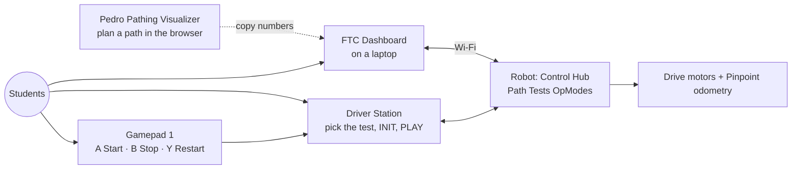
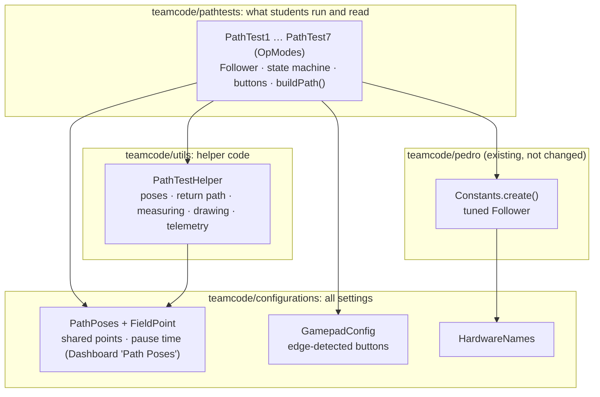
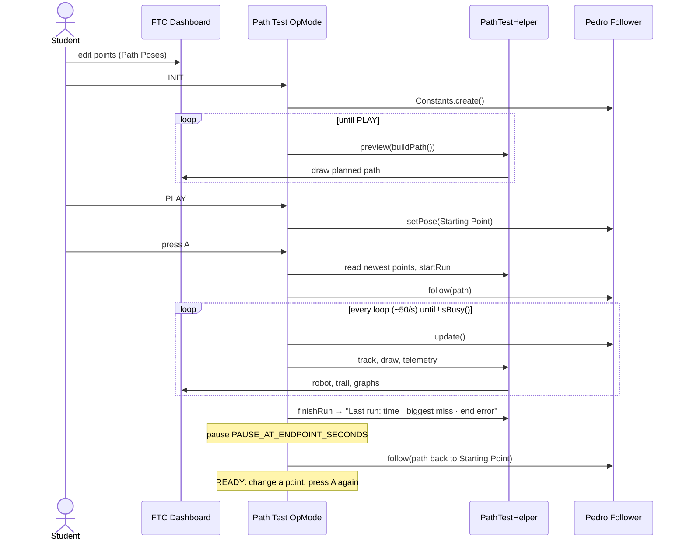

# Path Tests: High Level Design

| | |
|---|---|
| **Project** | PathLab (SMRC FTC 2026) |
| **Component** | Path Tests |
| **Audience** | Mentors, coaches, and anyone reviewing the design. Students start with §2 and §6. |
| **Related** | [Low Level Design](PathTests-LLD.md): classes, methods, code walkthrough, field procedures |
| **Status** | Built: configuration, helper, all 7 tests (compiles). Not yet run on the robot. |

---

## 1. Problem

Our students need to learn how a robot follows a path with
[Pedro Pathing](https://pedropathing.com/): what a control point does, how heading
choices change the robot's motion, and why some paths are more accurate than others.

Many have **no Java or Pedro Pathing experience**. Today the only way to try a path is to
edit Java, rebuild, and redeploy. That is slow, error-prone, and hides the ideas behind
the code.

## 2. Solution in one paragraph

**Path Tests** is a set of seven small robot programs (OpModes), one per way of building
a path. Every test uses the **same shared points** (Starting Point, Control Points,
Endpoint, Facing Point). Students edit those points live from **FTC Dashboard** on a laptop.
They press **A** on the gamepad to drive the path. The robot pauses at the end, then drives back to the
Starting Point by itself. The Dashboard field picture and the telemetry show the planned path, the real
path, and how far off the robot was. All names, coordinates and code style match the
[Pedro Pathing Visualizer](https://visualizer.pedropathing.com/), so students can plan
there and test here.

## 3. Goals and non-goals

| Goals | Non-goals |
|---|---|
| Teach path shapes: line, curve, through points | Tuning the follower (mentors use the Pedro tuners) |
| Teach heading options: constant, linear, tangent, reverse tangent, facing point | Red/blue mirroring, full autonomous routines |
| Teach the OpMode lifecycle: `init`, `init_loop`, `start`, `loop`, `stop` | Saving runs to files or automatic multiple trials |
| Compare approaches with **numbers** (time, biggest miss, end error) | Manual driving with joysticks |
| Change paths **without** editing code or redeploying | A simulator (tests run on the real robot) |
| Match the Pedro Pathing Visualizer so students can switch between them | |

## 4. Context

## 5. Components

| Component | Folder | Responsibility | Students |
|---|---|---|---|
| **Path Test OpModes** (7) | `pathtests/` | One path approach each. Owns the Follower, the button handling, the state machine (Ready → Driving → Pausing → Returning), and `buildPath()`. Shows every OpMode method. | Read and edit |
| **PathTestHelper** | `utils/` | Path tooling: turns configured points into Pedro poses (via `PoseFactory`), builds the path back to the Starting Point, measures each run, draws on the Dashboard field, writes the telemetry. **Never moves the robot.** | Read if curious |
| **PathPoses** + **FieldPoint** | `configurations/` | The shared points and pause time, editable live in Dashboard. | Edit in Dashboard |
| **GamepadConfig** (existing, not changed) | `configurations/` | Edge-detected buttons for all gamepad input. | Read |
| **Constants** (existing, not changed) | `pedro/` | Builds the tuned Follower (Mecanum drive, Pinpoint, Foresight). | Do not edit |

### The seven tests

| # | Path | Heading | Lesson |
|---|---|---|---|
| 1 | Line | Constant | Baseline |
| 2 | Line | Linear | Turning while driving |
| 3 | Curve (1 control point) | Tangent | Control points pull the curve |
| 4 | Curve (1 control point) | Reverse tangent | Driving backwards |
| 5 | Curve (2 control points) | Tangent | S-curves |
| 6 | Through points | Tangent | Passing *through* a point vs. being pulled toward it |
| 7 | Curve (1 control point) | Facing point | Aiming while moving |

## 6. How a run works

**Buttons (gamepad 1, through `GamepadConfig`):** **A** Start · **B** Stop (any time) ·
**Y** Restart (drive back to the Starting Point, then Ready).

## 7. Key design decisions

| # | Decision | Why | Alternatives rejected |
|---|---|---|---|
| D1 | **One OpMode per path approach**, each a complete `OpMode` with `init`/`init_loop`/`start`/`loop`/`stop` | Students learn the whole OpMode lifecycle; each file teaches one idea | A shared base class (hides how OpModes work); one OpMode with a menu (too much to read) |
| D2 | **Follower, `update()`, `follow()`, `isBusy()` and the state machine stay in the OpMode** | These are the core Pedro ideas; students should see them | Hiding them in the helper |
| D3 | **One helper (`PathTestHelper`) for path tooling only**, in `utils/` | Keeps drawing, measuring and formatting out of the way without hiding robot control | Several helper classes (more to explain) |
| D4 | **Nothing new goes in `pedro/`; all settings live in `teamcode/configurations/`.** OpModes in `pathtests/`, the helper in `utils/`, settings (`PathPoses`, `FieldPoint`, `GamepadConfig`, `HardwareNames`) in `configurations/` | `pedro/` holds only the Pedro Pathing quickstart (`Constants`, tuners), so Pedro updates stay easy; one folder to look in for anything you can change | Putting Path Tests files inside `pedro/`; settings split across folders |
| D5 | **Shared points for every test**, edited in **FTC Dashboard** | Fair comparisons (same points, different approach); no redeploys | Per-test settings (hard to compare); hard-coded points |
| D6 | **Names, coordinates and code style match the Pedro Pathing Visualizer** (Starting Point, Control Point, Endpoint; 141.5 in field; degrees; `PoseFactory.degrees()`, `Paths.curve(...)`) | Students plan in the visualizer and copy numbers or code across | Our own naming (two vocabularies to learn) |
| D7 | **`PoseFactory.degrees()` for every pose** | Students type degrees; avoids the "90 radians" mistake; same as visualizer export | `new Pose(..., Math.toRadians(...))` everywhere |
| D8 | **All gamepad input through `GamepadConfig`** | Reuses the team's edge-detection class; one press = one action | Raw `gamepad1.a` checks |
| D9 | **Automatic return to the Starting Point** after a configurable pause | Fast repeat runs; the robot always starts the next run from the same place | Students push the robot back by hand |
| D10 | **Points are read when A is pressed**; edits during a run apply to the next run | A run never changes halfway; results stay meaningful | Live-updating paths mid-run |
| D11 | **`@TeleOp`, not `@Autonomous`** | Autonomous OpModes get a 30-second auto-stop timer on the Driver Station | — |
| D12 | **`MultipleTelemetry`** to the Driver Station and Dashboard, with visualizer wording (Path number, Playback completion, Current path distance remaining) | The same information everywhere, in familiar words | Driver Station only |
| D13 | **Javadoc on every class and method, plus a comment on every OpMode line** | Students can learn from the code itself (hover in Android Studio) | Separate docs only |

## 8. Constraints and assumptions

- Pedro Pathing **3.0.1**, FTC Dashboard **0.6.0**, FTC SDK **12.0** (from `build.dependencies.gradle`).
- The follower is already tuned (`pedro/Constants.java`) and the Pinpoint localizer works.
- The robot does not know where it is on the field: at PLAY it is *told* it is at the Starting Point.
- Dashboard edits are not saved on the robot. Values worth keeping are copied into `PathPoses.java`.
- A clear area of about 4 × 3 tiles is available for the default points.

## 9. Risks

| Risk | Impact | Mitigation |
|---|---|---|
| Robot drives somewhere unexpected | Damage or injury | Preview on Dashboard before PLAY; **B** stops any time; small default paths; safety rules and roles in the LLD §9 |
| `isBusy()` stays true while holding the Endpoint | Run never "finishes" | Verify on robot; fall back to `atParametricEnd()` (used by the existing `Tests.java`) |
| Dashboard field picture flickers (our packet + `MultipleTelemetry`) | Hard to watch | Put telemetry lines in our own packet if needed |
| Dashboard picture rotated vs. the visualizer | Confusing | Check orientation with a known test path; adjust in the helper only |
| Students edit the wrong files | Broken build | Clear folder split (§5); `★` marks the only lines that change between tests |

## 10. Using it on the field (summary)

1. Plan a path in the visualizer and copy the points into Dashboard → *Configuration* → *Path Poses*.
2. Tape an **X** at the Starting Point and place the robot on it, facing the starting heading.
3. Driver Station: pick a test from the **Path Tests** group → INIT (check the Dashboard preview) → PLAY.
4. Press **A**. Watch the robot and the Dashboard trail. Write down the "Last run" numbers.
5. The robot returns by itself. Change **one** thing, predict, press **A** again.

Roles (Driver, Dashboard Operator, Recorder, Spotter), seven lessons, a worksheet, safety
rules and troubleshooting are in the [LLD §9](PathTests-LLD.md#9-using-path-tests-on-the-real-field).

## 11. Future work

- Test 8: two paths chained with `Paths.path(...)`.
- Red/blue alliance mirroring with `PoseFactory.degrees().mirrorX(70.75)`, as the visualizer exports.
- Save runs to CSV for graphing.
