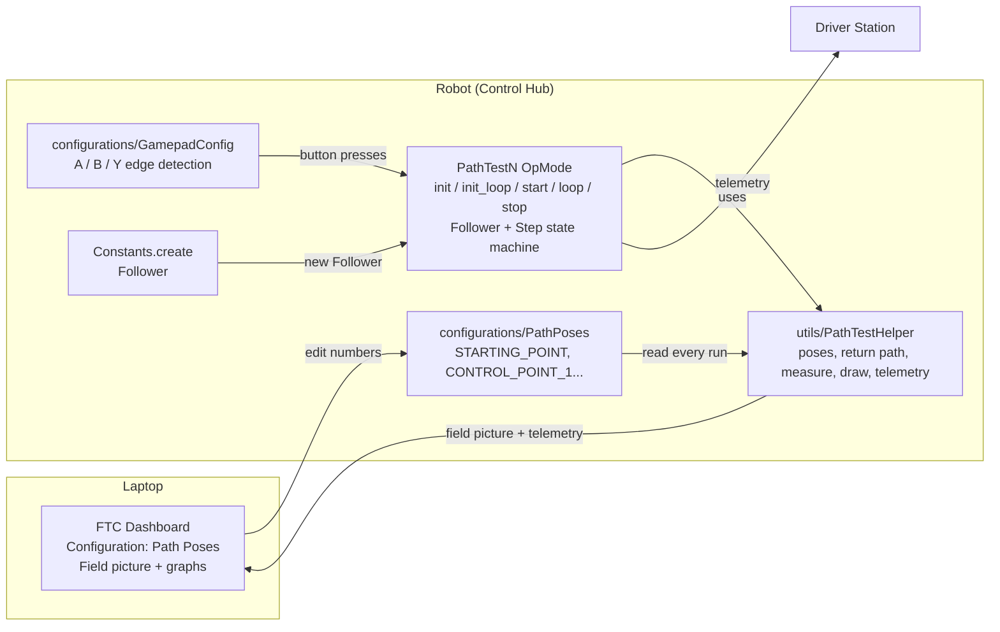
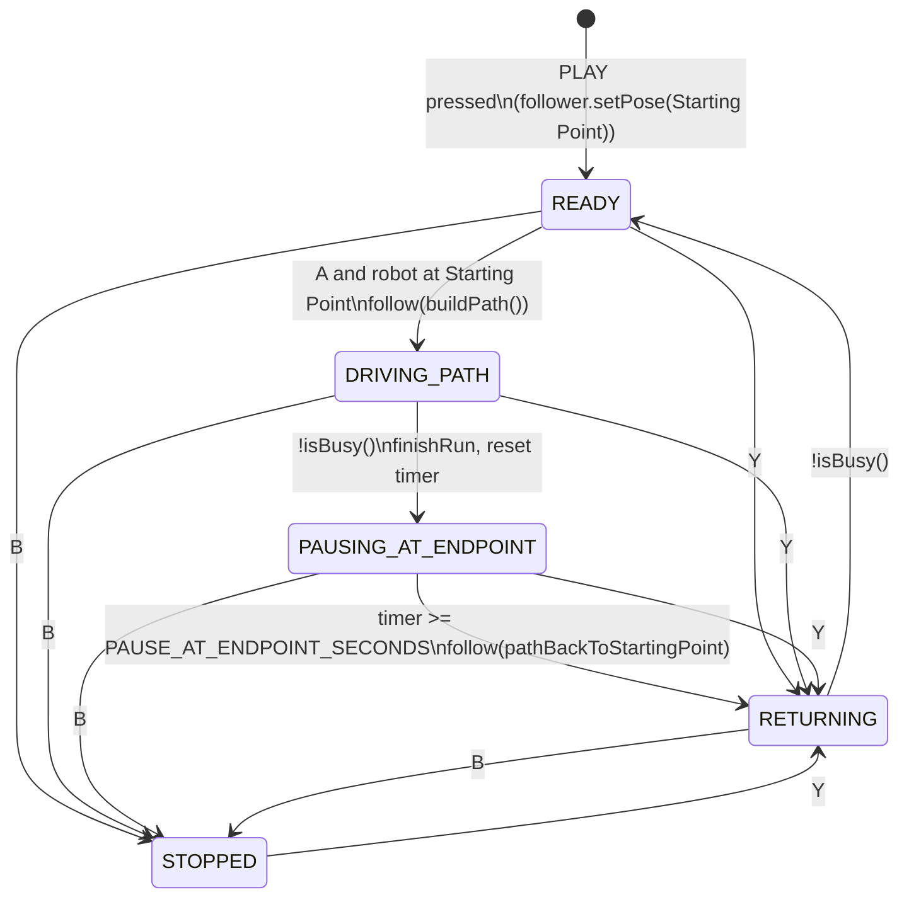

# Path Tests — Low Level Design

| | |
|---|---|
| **Project** | PathLab (SMRC FTC 2026) |
| **Component** | Path Tests: OpModes (`teamcode.pathtests`), helper (`teamcode.utils`), configuration (`teamcode.configurations`) |
| **Related** | [High Level Design](PathTests-HLD.md) |
| **Audience** | Students (no Java or Pedro Pathing experience needed) and their mentors |
| **Libraries** | Pedro Pathing 3.0.1 (`com.pedropathing:revhub`), FTC Dashboard 0.6.0, FTC SDK 12.0 |
| **Status** | Built: configuration, helper, all 7 tests (compiles). Not yet run on the robot (§11, §12). |

---

## 1. What this is

**Path Tests** is a set of small robot programs (OpModes). Each one drives the robot
along **one kind of Pedro Pathing path**, pauses at the end, and drives back to where it
started. Students change the points of the path **live from FTC Dashboard** on a laptop,
press a button on the gamepad, and watch what happens — on the real field and on the
Dashboard field picture.

Everything is named and shaped the same way as the
[Pedro Pathing Visualizer](https://visualizer.pedropathing.com/), so a path drawn in the
visualizer can be typed straight into Dashboard and driven for real.

### 1.1 Goals

1. Students learn **how a path is built** (line, curve, through points) and **how heading
   works** (constant, linear, tangent, reverse tangent, facing point).
2. Students learn **how an OpMode works** — `init()`, `init_loop()`, `start()`, `loop()`,
   `stop()` — because every OpMode shows all of them, with nothing hidden in a base class.
3. Students can **measure** each path (time, how far off the path the robot went) and
   compare approaches with numbers, not guesses.
4. No code edits or redeploys are needed to try new points.

### 1.2 Non-goals (deliberately left out to keep it simple)

- Tuning the follower (that is `pedro/Constants.java`, done by mentors with the Pedro tuners).
- Saving runs to files, running multiple trials automatically, mirroring for red/blue.
- Driving the robot by hand (sticks are not used).

---

## 2. Words you need to know (glossary)

| Word | Meaning |
|---|---|
| **Pose** | Where the robot is **and** which way it faces: `x`, `y` (inches) and `heading` (angle). |
| **Starting Point** | The pose where a path begins. Same name as in the visualizer. |
| **Control Point** | A point that **pulls** a curve toward it. The robot does **not** drive through it. |
| **Endpoint** | The pose where a path ends. |
| **Facing Point** | A spot on the field the robot keeps looking at while it drives. |
| **Path** | The route from Starting Point to Endpoint. Pedro builds it with `Paths.line(...)`, `Paths.curve(...)`, `Paths.through(...)`. |
| **Heading interpolation** | The rule for which way the robot faces **while** it drives (constant, linear, tangent...). |
| **Follower** | The Pedro Pathing "driver" — it reads where the robot is and powers the motors to stay on the path. |
| **PoseFactory** | Pedro's pose maker. `PoseFactory.degrees()` lets us type angles in degrees. |
| **OpMode** | One program you pick on the Driver Station. |
| **Edge detection** | Noticing the **moment** a button goes from up to down, so one press = one action. Done for us by `GamepadConfig`. |
| **State machine** | The OpMode is always in one **Step** (READY, DRIVING_PATH...). Each loop it checks if it should move to the next step. |
| **FTC Dashboard** | A web page (on the laptop) that shows a field picture, graphs, telemetry, and lets us edit numbers live. |
| **Telemetry** | Text the robot sends back to the Driver Station / Dashboard. |

---

## 3. Coordinates (same as the Pedro Pathing Visualizer)

```
 y (inches)
141.5 ┌───────────────────────────────┐
      │                               │
      │                               │
      │        Endpoint (72,60) ●     │
      │                    ╱          │
      │                   ╱           │
      │      ●───────────○ Control Point 1 (60,24)
      │ Starting Point (24,24)        │
    0 └───────────────────────────────┘ x (inches)
      0                             141.5
```

- The field is **141.5 × 141.5 inches**. `(0, 0)` is the **bottom-left corner** as drawn in the visualizer.
- `x` grows to the **right**, `y` grows **up**.
- `heading` is in **degrees**. `0°` = facing right (+x), `90°` = facing up (+y). Counter-clockwise is positive.
- One foam tile is about **23.6 inches**, so the field is 6 × 6 tiles.

> **Important:** the robot does not *know* where it is on the field. When you press PLAY the
> OpMode **tells** it "you are at the Starting Point". If you place the robot somewhere else, it
> drives the same shape, just shifted. To match the visualizer picture, put the robot on the
> real field spot (see §9).

---

## 4. Files

**Nothing new goes in `pedro/`.** That folder holds the Pedro Pathing quickstart and stays as it is.
Everything goes in four folders directly under `TeamCode/src/main/java/org/firstinspires/ftc/teamcode/`:

- **`configurations/`**: **every setting lives here**, next to the existing `GamepadConfig` and
  `HardwareNames`. If a student wants to change a setting, this is the only folder they look in.
- **`utils/`**: helper code that the OpModes use but students don't need to change.
- **`pathtests/`**: only the OpModes students run and read.
- **`doc/`**: `PathTests-HLD.md` (high level design) and `PathTests-LLD.md` (this document).
  They sit next to the code so students find them in Android Studio. Gradle ignores `.md`
  files, so they do not affect the build.

**`configurations/` (new files)**

| File | What it is | Students edit it? |
|---|---|---|
| `FieldPoint.java` | The **shape** of one configured point: `x`, `y`, `heading`. Holds values only, no logic (see §6.1) | No |
| `PathPoses.java` | **The shared points** (Dashboard panel "Path Poses") + pause time | Only via Dashboard (defaults in code) |

**`utils/` (new folder)**

| File | What it is | Students edit it? |
|---|---|---|
| `PathTestHelper.java` | Helper for path tooling: poses, return path, measuring, drawing, telemetry | No (read it if curious) |

**`pathtests/`**

| File | What it is | Students edit it? |
|---|---|---|
| `PathTest1_StraightLineKeepHeading.java` | OpMode — line, heading stays the same | Yes |
| `PathTest2_StraightLineTurnWhileDriving.java` | OpMode — line, heading turns smoothly | Yes |
| `PathTest3_CurveFaceDirectionOfTravel.java` | OpMode — curve, robot faces where it drives | Yes |
| `PathTest4_CurveDriveBackward.java` | OpMode — curve, robot drives backwards | Yes |
| `PathTest5_SCurveTwoControlPoints.java` | OpMode — S-shaped curve | Yes |
| `PathTest6_CurveThroughAPoint.java` | OpMode — passes *through* a point | Yes |
| `PathTest7_CurveKeepFacingAPoint.java` | OpMode — keeps looking at one spot | Yes |

Existing files used (not changed):

| File | Used for |
|---|---|
| `pedro/Constants.java` | `Constants.create(hardwareMap)` builds the tuned Follower |
| `configurations/GamepadConfig.java` | **All** gamepad buttons (edge detected) |
| `configurations/HardwareNames.java` | Motor / Pinpoint names (used inside `Constants`) |

### 4.1 Why it is called "Path Tests" and not "PathLab"

`PathLab` is the whole repository. **Path Tests** says exactly what the package does: each
OpMode *tests one kind of path*. The helper is `PathTestHelper` because it *helps* the
tests — it never drives the robot by itself.

---

## 5. Architecture



**Where configuration lives (design rule):** every value a person might want to change
(points, pause time, gamepad mapping, hardware names) lives in `configurations/`.
The `pathtests/` and `utils/` folders hold **no** settings. The few constants inside `PathTestHelper`
(drawing sizes, the 2-inch "at the Starting Point" tolerance) are fixed implementation
details, not settings. If one ever needs changing, it moves to `PathPoses`.

**Who owns what (design rule):**

| The OpMode owns (students see it) | `PathTestHelper` owns (path tooling) |
|---|---|
| Creating the Follower | Turning `PathPoses` numbers into Pedro `Pose`s (via `PoseFactory`) |
| `follower.update()` every loop | Building the "drive back" path |
| `follower.follow(...)`, `follower.hold(...)`, `follower.stop()` | Measuring time / biggest miss / end error |
| `follower.isBusy()` checks | Drawing on the Dashboard field |
| Reading buttons with `GamepadConfig` | Writing the telemetry screen |
| The Step state machine and the pause timer | Noticing Dashboard changes |
| Creating `MultipleTelemetry` | |

---

## 6. Class designs

### 6.1 `FieldPoint` (`configurations/FieldPoint.java`)

A tiny "data holder". FTC Dashboard shows every public field of an object as an editable
box, so a `FieldPoint` shows up in Dashboard as a group with `x`, `y`, `heading`.

| Member | Meaning |
|---|---|
| `public double x` | Inches from the left edge of the field (0 to 141.5) |
| `public double y` | Inches from the bottom edge of the field (0 to 141.5) |
| `public double heading` | Degrees. 0 = right, 90 = up, counter-clockwise is positive |
| `FieldPoint(double x, double y, double heading)` | Makes a point, e.g. `new FieldPoint(24, 24, 0)` |

Rules: fields are `public` and **not** `final` (Dashboard can only edit non-final public fields).
There are no other methods; text formatting for telemetry lives in `PathTestHelper`.

**Is `FieldPoint` a helper or a configuration?** It is **configuration**. It has no logic
(no Pedro calls, no math, nothing that moves the robot). It only describes what one
configured point looks like, so that Dashboard shows `x`, `y` and `heading` together as a group.
`PathPoses` cannot work without it, so the two stay together in `configurations/`.
Turning a `FieldPoint` into a Pedro `Pose` (the actual work) happens in `PathTestHelper`.

### 6.2 `PathPoses` (`configurations/PathPoses.java`) — the shared configuration

```java
/**
 * The points every Path Test uses. Shows up in FTC Dashboard as the "Path Poses" panel.
 *
 * <p>Names match the Pedro Pathing Visualizer (Starting Point, Control Point, Endpoint,
 * Facing Point), so you can copy numbers from the visualizer into Dashboard.
 *
 * <p>Changes made in Dashboard are used the next time you press A (Start). They are
 * <b>not</b> saved when the robot turns off — copy good values back into this file.
 */
@Config("Path Poses")
public class PathPoses {
    /** Where every path begins, and where the robot returns to. */
    public static FieldPoint STARTING_POINT  = new FieldPoint(24, 24, 0);
    /** Pulls the curve toward it (tests 3, 4, 5, 7). Test 6 drives THROUGH it. */
    public static FieldPoint CONTROL_POINT_1 = new FieldPoint(60, 24, 0);
    /** Second pull point for the S-curve (test 5). */
    public static FieldPoint CONTROL_POINT_2 = new FieldPoint(36, 60, 0);
    /** Where every path ends. */
    public static FieldPoint ENDPOINT        = new FieldPoint(72, 60, 90);
    /** The spot the robot keeps looking at (test 7). Heading is ignored. */
    public static FieldPoint FACING_POINT    = new FieldPoint(96, 96, 0);

    /** How long the robot waits at the Endpoint before driving back, in seconds. */
    public static double PAUSE_AT_ENDPOINT_SECONDS = 2.0;
}
```

Design notes:

- Control Point and Facing Point headings are unused by Pedro but kept so every point looks the same in Dashboard.
- Defaults fit in a **3 × 2 tile** area so tests can run on a half field.
- `CONTROL_POINT_2` sits on the **other side** of the path from `CONTROL_POINT_1` (left of the
  Endpoint, while Control Point 1 is to the right). That is what makes test 5 an S; with both
  on the same side the curve is just a hook.
- **Starting Point heading matters for tests 4 and 7.** With the default heading (0), test 4
  (drive backward) spins 180° at the start, and test 7 (facing point) turns 45° to face the
  Facing Point. Each test's description tells students what heading to set to avoid this.
- `public static` (not `final`) is required for Dashboard to edit them.

### 6.3 `PathTestHelper` (`utils/PathTestHelper.java`)

```java
/**
 * Path tooling shared by all Path Tests: makes poses from {@link PathPoses}, builds the
 * path back to the Starting Point, measures each run, draws the field picture on FTC
 * Dashboard, and writes the telemetry screen.
 *
 * <p>It never creates the Follower and never moves the robot. The OpMode does that.
 */
public class PathTestHelper { ... }
```

**Constants**

| Name | Value | Why |
|---|---|---|
| `POSES` | `PoseFactory.degrees()` | Same factory the visualizer exports; converts degrees → radians for Pedro |
| `AT_START_TOLERANCE_INCHES` | `2.0` | "Close enough" to the Starting Point to allow a new run |
| `FIELD_SIZE` | `141.5` | Visualizer field size, used to center the Dashboard drawing |
| `ROBOT_RADIUS` | `9.0` | Size of the robot circle on the field picture |
| `POINT_RADIUS` | `2.0` | Size of the dot drawn for each point |
| `PATH_DRAW_STEPS` | `50` | The planned path is drawn as a line through 51 points |
| `MAX_TRAIL_POINTS` | `1000` | How many past positions to draw as the robot's trail |
| `COLOR_*` | web color names | Colors for the field picture (§6.3.1) |

**Fields (private)**

| Field | Type | Meaning |
|---|---|---|
| `testName` | `String` | Shown at the top of telemetry, e.g. `"Path 3: Curve - Face Direction of Travel"` |
| `headingName` | `String` | Shown in telemetry, e.g. `"Tangent"` (matches visualizer dropdown) |
| `dashboard` | `FtcDashboard` | Used to send the field picture |
| `usesControlPoint1`, `usesControlPoint2`, `usesFacingPoint` | `boolean` | Become true the first time `buildPath()` asks for that point, so the picture and telemetry show **only the points this test uses** |
| `runTimer` | `ElapsedTime` | Time since the current run started |
| `running` | `boolean` | True between `startRun` and `finishRun` |
| `biggestMiss` | `double` | Largest distance from the path in this run (inches) |
| `missNow` | `double` | Distance from the path right now (inches) |
| `lastRunText` | `String` | The "Last run: ..." line |
| `trailX`, `trailY` | `List<Double>` | Robot positions this run, for the trail drawing |

**Methods (public)**

| Method | Javadoc summary | Pedro / Dashboard calls inside |
|---|---|---|
| `PathTestHelper(String testName, String headingName)` | Gets the Dashboard instance, remembers names. | `FtcDashboard.getInstance()` |
| `Pose startingPoint()` | The Starting Point from Dashboard as a Pedro pose. | `POSES.of(x, y, heading)` |
| `Pose controlPoint1()` / `controlPoint2()` | Control points as Pedro poses. | `POSES.of(...)` |
| `Pose endpoint()` | The Endpoint as a Pedro pose. | `POSES.of(...)` |
| `Pose facingPoint()` | The Facing Point as a Pedro pose. | `POSES.of(...)` |
| `Path pathBackToStartingPoint(Pose from)` | Straight line from `from` to the Starting Point, turning smoothly to the starting heading. Only call when **not** already at the Starting Point (a zero-length line has no direction). | `Paths.line(from, start).linear(from, start)` |
| `boolean isAtStartingPoint(Pose robot)` | True if the robot is within 2 in of the Starting Point. | `Pose.distance` |
| `void startRun(Path path)` | Starts the stopwatch, clears biggest miss and trail, snapshots `PathPoses`. | — |
| `void track(Follower follower)` | Each loop: updates `missNow`, `biggestMiss`, trail. Does nothing if not running. | `follower.pose()`, `follower.closestPose()` |
| `void finishRun(Follower follower, Path path)` | Stops the stopwatch, computes end error, builds `lastRunText`. | `path.endPose()`, `follower.pose()` |
| `void preview(Path path)` | Draws the planned path and points (before PLAY). | `TelemetryPacket.fieldOverlay()`, `sendTelemetryPacket` |
| `void draw(Follower follower, Path path)` | Draws planned path, points, trail, robot; puts graph values (speed and completion only while following). | `Path.get(t)`, `Canvas.strokePolyline`, `strokeCircle`, `strokeLine`, `follower.tangentialVelocity()` |
| `void showTelemetry(Telemetry t, Follower f, String step, String telemetryMessage)` | Writes the telemetry screen (§7) and calls `t.update()`. Adds a `Message` line only when `telemetryMessage` is not empty. | `follower.pathIndex()`, `completion()`, `remainingDistance()` |

**Example Javadoc (every public method gets one like this):**

```java
/**
 * Makes the path that drives the robot back to the Starting Point.
 *
 * <p>It is a straight line from where the robot is now, and the robot turns smoothly
 * from its current heading to the Starting Point heading while it drives.
 *
 * <p>We build it from the robot's <i>current</i> pose (not the Endpoint) so it also works
 * after you press B (Stop) in the middle of a path.
 *
 * @param from where the robot is right now, usually {@code follower.pose()}
 * @return a path the OpMode can give to {@code follower.follow(...)}
 */
public Path pathBackToStartingPoint(Pose from) {
    Pose start = startingPoint();
    return Paths.line(from, start).linear(from, start);
}
```

**Measuring — definitions**

| Number | How it is computed |
|---|---|
| Time | `runTimer.seconds()` from `startRun` to `finishRun` |
| Off the path right now | distance between `follower.pose()` and `follower.closestPose()` (inches) |
| Biggest miss | largest "off the path" value during the run |
| Ended … in off | distance between `follower.pose()` and `path.endPose()` at `finishRun` |
| Ended … ° off | `Angle.smallestDifference(robot heading, path end heading)` (0–180°), in degrees. The "path end heading" is what the path's heading rule wants at the end (e.g. the tangent direction for test 3), not always the Endpoint's typed heading. |

#### 6.3.1 How the position is drawn on the Dashboard field

The robot's position on the Dashboard field is redrawn **every loop (about 50 times a
second)** by `PathTestHelper.draw()`. Before PLAY, `preview()` draws the same picture without
the robot and trail.

```
Pinpoint odometry ──► follower.update() ──► follower.pose() ──► PathTestHelper.draw()
                                                                      │
                     FTC Dashboard field view ◄── sendTelemetryPacket ┘
```

**Step by step**

1. **Pedro works out where the robot is.** `follower.update()` (the first line of `loop()`)
   reads the Pinpoint. `follower.pose()` returns `x`, `y` in inches and `heading` in radians,
   in Pedro/visualizer coordinates (0 to 141.5, origin at the corner).
2. **The helper builds a drawing.** Dashboard's field view is a canvas. Every
   `TelemetryPacket` has a `fieldOverlay()` (a `Canvas`); shapes drawn on it appear on top
   of the field image.
3. **The helper converts coordinates.** Dashboard's field has its origin at the **center**
   (about −72 to +72 inches); Pedro's is at the **corner**. `toDashX` / `toDashY` subtract
   `FIELD_SIZE / 2` (70.75) from every `x` and `y`.
4. **The helper sends the packet** with `FtcDashboard.getInstance().sendTelemetryPacket(packet)`.
   Each packet **replaces** the previous drawing, which is what makes the robot appear to move.

**What is drawn**

| Item | Shape | Color | Source |
|---|---|---|---|
| Planned path | line through 51 points | gray | `path.get(t)` for `t = 0, 0.02 … 1` |
| Starting Point | filled circle, r = 2 | green | `startingPoint()` |
| Control Point 1 / 2 | hollow circle, r = 2 | blue | `controlPoint1()`, `controlPoint2()` (only if the test uses them) |
| Endpoint | filled circle, r = 2 | red | `endpoint()` |
| Facing Point | filled circle, r = 2 | orange | `facingPoint()` (test 7 only) |
| Trail (this run) | line through recorded positions | purple | positions saved by `track()` |
| Robot | circle, r = `ROBOT_RADIUS` | black | `follower.pose()` |
| Robot heading | line from robot center to its edge | black | `follower.pose().heading()` |

Graph values added to the same packet (`packet.put`), shown in Dashboard's **Graph** view:
`Off the path (in)`, `Speed (in/s)`, `Playback completion (%)`.

**Sketch of `draw()`**

```java
/**
 * Draws the field picture on FTC Dashboard: the planned path, the points, the robot's
 * trail, and the robot itself. Call once per loop.
 *
 * <p>Pedro measures from the field corner; Dashboard measures from the field center,
 * so every point goes through {@link #toDashX} / {@link #toDashY} first.
 *
 * @param follower the Follower, to read where the robot is
 * @param path     the path being driven, or {@code null} before the first run
 */
public void draw(Follower follower, Path path) {
    TelemetryPacket packet = new TelemetryPacket();
    Canvas field = packet.fieldOverlay();
    Pose robot = follower.pose();

    // Planned path: 51 points along the path, joined by a gray line
    if (path != null) {
        double[] xs = new double[51], ys = new double[51];
        for (int i = 0; i <= 50; i++) {
            Pose p = path.get(i / 50.0);
            xs[i] = toDashX(p.x());
            ys[i] = toDashY(p.y());
        }
        field.setStroke("gray").strokePolyline(xs, ys);
    }

    drawPoints(field);                                   // Starting Point, control points, Endpoint...

    // Trail: every position recorded by track() during this run
    field.setStroke("purple").strokePolyline(trailXs(), trailYs());

    // Robot: a circle, plus a line from the center showing which way it faces
    double rx = toDashX(robot.x()), ry = toDashY(robot.y());
    field.setStroke("black").strokeCircle(rx, ry, ROBOT_RADIUS);
    field.strokeLine(rx, ry,
            rx + ROBOT_RADIUS * Math.cos(robot.heading()),
            ry + ROBOT_RADIUS * Math.sin(robot.heading()));

    packet.put("Off the path (in)", missNow);           // Dashboard Graph view
    dashboard.sendTelemetryPacket(packet);
}

/** Pedro x (0 to 141.5, from the corner) → Dashboard x (from the center). */
private double toDashX(double pedroX) { return pedroX - FIELD_SIZE / 2; }

/** Pedro y (0 to 141.5, from the corner) → Dashboard y (from the center). */
private double toDashY(double pedroY) { return pedroY - FIELD_SIZE / 2; }
```

**Things to know**

- **The picture shows where the robot *thinks* it is, not where it really is.** At PLAY the
  OpMode tells the Follower "you are at the Starting Point". If the robot was placed somewhere
  else, the picture still shows it on the Starting Point. If the odometry drifts or a wheel
  slips, the picture drifts too. Comparing the picture with the real robot is a lesson in
  itself: this is exactly what localization means.
- **Rotation is checked on the robot.** Moving the origin to the center is certain. Whether
  Dashboard's +x points right or up on screen is confirmed with test 1 (§11 item 3). If it
  points up, `toDashX` / `toDashY` swap axes (or the helper calls `Canvas.setRotation`) so
  the picture matches the visualizer. The change stays inside these two methods.
- **Possible flicker.** `MultipleTelemetry` also sends Dashboard packets, which have no
  drawing. If the picture flickers between the two, the helper adds the telemetry lines to
  its own packet and `MultipleTelemetry` is used for the Driver Station only (§11 item 4).
- **Trail size.** The trail keeps at most `MAX_TRAIL_POINTS` positions and is cleared by
  `startRun()`, so each run shows only its own track.

### 6.4 The OpModes (`PathTest1` … `PathTest7`)

All seven are **the same file** except the lines marked ★: the `@TeleOp` name, the class
name, the helper constructor names, the body of `buildPath()`, and the description at the top.
**All seven are built.** Tests 2–7 were copied from test 1 and changed only on the ★ lines
and in the description at the top (what the test does, what to compare, and, for tests 4 and 7,
a "before you start" note about the Starting Point heading).

**Naming rules**

- **Driver Station name:** `Path N: <path shape> - <what the robot does>`, e.g.
  `Path 2: Straight Line - Turn While Driving`. Students should know what a test does from
  the name alone. The number keeps the list in teaching order (the Driver Station sorts by name).
- **Class and file name:** the Driver Station name in CamelCase after `PathTestN_`, e.g.
  `Path 2: Straight Line - Turn While Driving` → `PathTest2_StraightLineTurnWhileDriving.java`,
  so the file list in Android Studio reads the same as the Driver Station list.
- **Heading word in telemetry** (the `"Heading"` line): the visualizer's own word
  (`Constant`, `Linear`, `Tangent`, `Reverse Tangent`, `Facing Point`), so students can find the
  same option in the visualizer.
- **Helper variable:** `pathTestHelper`, the class name in camelCase, so it's obvious what it is
  wherever it's used (`pathTestHelper.startingPoint()`).

| OpMode (Driver Station name) | `buildPath()` | Visualizer heading option | What to look for |
|---|---|---|---|
| `Path 1: Straight Line - Keep Heading` | `Paths.line(pathTestHelper.startingPoint(), pathTestHelper.endpoint()).constant(pathTestHelper.startingPoint())` | Constant | The baseline. Robot slides sideways if needed. |
| `Path 2: Straight Line - Turn While Driving` | `Paths.line(pathTestHelper.startingPoint(), pathTestHelper.endpoint()).linear(pathTestHelper.startingPoint(), pathTestHelper.endpoint())` | Linear | Turns while driving. Is it less accurate than test 1? |
| `Path 3: Curve - Face Direction of Travel` | `Paths.curve(pathTestHelper.startingPoint(), pathTestHelper.controlPoint1(), pathTestHelper.endpoint()).tangent()` | Tangent | Robot always faces the way it is driving. |
| `Path 4: Curve - Drive Backward` | `Paths.curve(pathTestHelper.startingPoint(), pathTestHelper.controlPoint1(), pathTestHelper.endpoint()).reverseTangent()` | Tangent + Reverse | Same curve, robot drives backwards. |
| `Path 5: S-Curve - Two Control Points` | `Paths.curve(pathTestHelper.startingPoint(), pathTestHelper.controlPoint1(), pathTestHelper.controlPoint2(), pathTestHelper.endpoint()).tangent()` | Tangent | S-curves. Move Control Point 2 and watch the shape change. |
| `Path 6: Curve Through a Point` | `Paths.through(pathTestHelper.startingPoint(), pathTestHelper.controlPoint1(), pathTestHelper.endpoint()).tangent()` | Tangent | Robot drives **through** Control Point 1 instead of being pulled toward it. Compare with test 3. |
| `Path 7: Curve - Keep Facing a Point` | `Paths.curve(pathTestHelper.startingPoint(), pathTestHelper.controlPoint1(), pathTestHelper.endpoint()).facingPoint(pathTestHelper.facingPoint())` | Facing Point | Robot keeps "looking" at the Facing Point. |

**Why `@TeleOp` and not `@Autonomous`:** the Driver Station starts a 30-second timer for
Autonomous OpModes and stops them. Path Tests run until you press STOP, so they are TeleOp.

**Why the heading uses poses, not numbers:** `.constant(pathTestHelper.startingPoint())` uses the
heading stored in the pose (already converted to radians by `PoseFactory`). Typing
`.constant(90)` would be read as 90 **radians** — a classic mistake.

---

## 7. Telemetry screen (Driver Station and Dashboard)

Uses `MultipleTelemetry`, so the same text appears on both. Wording matches the visualizer.

```
Path 3: Curve - Face Direction of Travel
Buttons: A = Start   B = Stop   Y = Restart
Step: DRIVING_PATH
Message: (only when there is one)

Starting Point      x 24.0   y 24.0   heading 0°
Control Point 1     x 60.0   y 24.0
Endpoint            x 72.0   y 60.0   heading 90°
Heading             Tangent

Robot               x 51.3   y 33.9   heading 41°
Path number         1 / 1
Playback completion 58%
Current path distance remaining   21.4 in
Off the path right now            0.9 in

Last run: time 2.6 s · biggest miss 1.8 in · ended 0.4 in / 2° off
```

**Messages** (the `telemetryMessage` variable in the OpMode). Kept to a bare minimum to avoid
clutter: the `Step` line and the button legend already say what is happening and which
buttons do what. A message appears only when the driver **needs to act**, or needs to know **why a button
is not working**:

| When | Message |
|---|---|
| Before PLAY (`init_loop`) | `Put the robot on the Starting Point, then press PLAY` |
| READY, robot at the Starting Point | `Press A to start` (after PLAY the robot waits, which surprises beginners; it also shows after every run) |
| READY, but the Starting Point was moved in Dashboard (A is blocked) | `Starting Point moved. Press Y to drive there first` |

Dashboard edits made during a run have no message: they are simply used on the next A press
(see §9.8).

---

## 8. OpMode behavior

### 8.1 Buttons (all through `GamepadConfig`, gamepad 1)

| Button | `GamepadConfig` call | Action | Allowed in step |
|---|---|---|---|
| **A** | `driver.isAPressed()` | **Start** — build the path from the newest Dashboard numbers and drive it | READY, and robot at Starting Point |
| **B** | `driver.isBPressed()` | **Stop** — hold the robot where it is | any |
| **Y** | `driver.isYPressed()` | **Restart** — drive back to the Starting Point (newest numbers), then READY | any |

`GamepadConfig` remembers last loop's button state *inside each `isXPressed()` call*.
**Each method must be called exactly once per loop**, so the OpMode reads all three into
variables at the top of `loop()` and uses the variables after that.

### 8.2 Steps (state machine)



Y and the end of the pause both call the OpMode's `driveBackToStartingPoint()`. If the robot
is **already** at the Starting Point it goes straight to READY (holding still) instead of
RETURNING, because a line from a point to itself has no direction for Pedro to follow.

### 8.3 What happens in each OpMode method

| Method | When it runs | What it does |
|---|---|---|
| `init()` | Once, when INIT is pressed | Combine telemetry for Driver Station + Dashboard, create the Follower, create `GamepadConfig`, create the helper, set the robot's pose to the Starting Point (so the screen shows it there) |
| `init_loop()` | Again and again until PLAY | Draw a preview of the path on Dashboard (updates live as you edit numbers), show telemetry |
| `start()` | Once, when PLAY is pressed | Tell the Follower "you are at the Starting Point" again (it may have been changed during INIT), Step = READY |
| `loop()` | About 50 times a second until STOP | Update Follower → read buttons → handle Stop/Restart → do the current Step → measure → draw → telemetry |
| `stop()` | Once, when STOP is pressed | Stop the motors |
| `driveBackToStartingPoint()` | Called by Y and at the end of the pause | Hold if already at the Starting Point (→ READY), otherwise follow the path back (→ RETURNING) |

### 8.4 Walkthrough of a Path Test OpMode

This walks through `pathtests/PathTest1_StraightLineKeepHeading.java` from top to bottom. The file
itself has a comment on every line or small block; this section explains the **why**.
Lines marked **★** in the file are the only ones that change between Path Tests.

#### a) Package and imports

```java
package org.firstinspires.ftc.teamcode.pathtests;

import com.acmerobotics.dashboard.FtcDashboard;
import com.acmerobotics.dashboard.telemetry.MultipleTelemetry;
import com.pedropathing.api.Paths;
import com.pedropathing.follower.Follower;
import com.pedropathing.paths.Path;
import com.qualcomm.robotcore.eventloop.opmode.OpMode;
import com.qualcomm.robotcore.eventloop.opmode.TeleOp;
import com.qualcomm.robotcore.util.ElapsedTime;

import org.firstinspires.ftc.teamcode.configurations.GamepadConfig;
import org.firstinspires.ftc.teamcode.configurations.PathPoses;
import org.firstinspires.ftc.teamcode.pedro.Constants;
import org.firstinspires.ftc.teamcode.utils.PathTestHelper;
```

| Code | Why |
|---|---|
| `package ...pathtests;` | The folder this file lives in. Java needs it to find the file. |
| `com.acmerobotics.dashboard...` | FTC Dashboard: the web page, and `MultipleTelemetry` to send text to it. |
| `com.pedropathing...` | Pedro Pathing: `Paths` makes paths, `Follower` drives them, `Path` is one path. |
| `com.qualcomm...` | FTC SDK: `OpMode` (what we build on), `@TeleOp` (puts us on the Driver Station list), `ElapsedTime` (a stopwatch). |
| `...configurations.*` | Our settings: the gamepad helper and the shared points. |
| `...pedro.Constants` | Our tuned Follower. |
| `...utils.PathTestHelper` | Our helper for poses, measuring, drawing and telemetry. |

#### b) The class header

```java
@TeleOp(name = "Path 1: Straight Line - Keep Heading", group = "Path Tests")      // ★
public class PathTest1_StraightLineKeepHeading extends OpMode {             // ★
```

- `@TeleOp(...)` is an **annotation**: a label the FTC SDK reads. It puts this OpMode on the
  Driver Station list with this name, inside the "Path Tests" group. We use TeleOp, not
  Autonomous, because Autonomous OpModes get a 30-second auto-stop timer.
- `extends OpMode` means our class **is an** OpMode. The SDK will call our `init()`,
  `init_loop()`, `start()`, `loop()` and `stop()` at the right times (§8.3).

#### c) The Steps and the things we keep

```java
enum Step { READY, DRIVING_PATH, PAUSING_AT_ENDPOINT, RETURNING, STOPPED }

Follower follower;
GamepadConfig driver;
PathTestHelper pathTestHelper;
Path path;
Step step = Step.READY;
ElapsedTime pauseTimer = new ElapsedTime();
```

- An `enum` is a fixed list of names. These are the Steps of the state machine (§8.2).
- The other lines are **fields**: values the OpMode keeps between loops. Variables made
  inside `loop()` are forgotten at the end of each loop; fields are not.
- `path` stays empty (`null`) until A is pressed the first time.

#### d) `buildPath()`: the one idea this test is about ★

```java
Path buildPath() {
    return Paths.line(pathTestHelper.startingPoint(), pathTestHelper.endpoint())
            .constant(pathTestHelper.startingPoint());
}
```

- `Paths.line(a, b)` makes a straight line from `a` to `b`.
- `.constant(pose)` is the **heading rule**: face that pose's heading the whole way.
  We pass a pose (not a number) because the pose's heading is already converted from degrees
  to radians by `PoseFactory`. Typing `.constant(90)` would mean 90 **radians**.
- `pathTestHelper.startingPoint()` and `pathTestHelper.endpoint()` read the **newest** numbers from Dashboard every
  time, so `buildPath()` always uses what is on the screen right now.
- This line is written exactly like the Pedro Pathing Visualizer's exported code.
- **Test 2** changes only this method: `.linear(pathTestHelper.startingPoint(), pathTestHelper.endpoint())`, meaning
  "turn smoothly from the Starting Point heading to the Endpoint heading".

#### e) `init()`: once, when INIT is pressed

```java
telemetry = new MultipleTelemetry(telemetry, FtcDashboard.getInstance().getTelemetry());
follower = Constants.create(hardwareMap);
driver = new GamepadConfig(gamepad1);
pathTestHelper = new PathTestHelper("Path 1: Straight Line - Keep Heading", "Constant");     // ★
follower.setPose(pathTestHelper.startingPoint());
```

| Line | Why |
|---|---|
| `MultipleTelemetry(...)` | Every telemetry line now goes to **both** the Driver Station and Dashboard. |
| `Constants.create(hardwareMap)` | Builds the Follower from our tuned settings: the mecanum motors, the Pinpoint, and the Foresight controller. `hardwareMap` is how the SDK finds devices by name. |
| `new GamepadConfig(gamepad1)` | Wraps gamepad 1 so each press counts once. |
| `new PathTestHelper(...)` | Our helper, with the names to show on screen. |
| `follower.setPose(...)` | Tells the Follower "the robot is at the Starting Point", so the telemetry and picture show it there before PLAY. |

#### f) `init_loop()`: again and again until PLAY

```java
pathTestHelper.preview(buildPath());
pathTestHelper.showTelemetry(telemetry, follower, "WAITING FOR PLAY",
        "Put the robot on the Starting Point, then press PLAY");
```

The robot cannot move before PLAY, so this is the safe time to **check the path**. The
preview is rebuilt every loop, so editing numbers in Dashboard changes the picture right away.

#### g) `start()`: once, when PLAY is pressed

```java
follower.setPose(pathTestHelper.startingPoint());
step = Step.READY;
```

The Starting Point is set again because someone may have changed it in Dashboard during INIT.

#### h) `loop()`: about 50 times a second until STOP

The loop always does the same five things in the same order:

```
1. follower.update()             where are we, and set the motor powers
2. read the buttons              once each
3. B and Y                       work in every Step
4. switch (step)                 the work for the current Step
5. track, draw, showTelemetry    measure, picture, screen
```

**1. Update the Follower first.**

```java
follower.update();
```

The Follower reads the Pinpoint (where are we?) and sets the motor powers (how do we stay on
the path, or hold still?). If this line is missing, the robot never moves.

**2. Read each button once.**

```java
boolean startPressed = driver.isAPressed();
boolean stopPressed = driver.isBPressed();
boolean restartPressed = driver.isYPressed();
String telemetryMessage = "";
```

`GamepadConfig` remembers the button state **inside** each `isXPressed()` call. Calling the
same method twice in one loop would make the second call miss the press, so we read each
button into a variable once and use the variable after that.

`telemetryMessage` starts empty every loop. Only the `READY` case below sets it (§7), so
while the robot is driving, pausing or returning there is no `Message` line.

**3. Stop and Restart work in every Step.**

```java
if (stopPressed) {
    follower.hold(follower.pose());
    step = Step.STOPPED;
}
if (restartPressed) {
    driveBackToStartingPoint();
}
```

- `follower.hold(pose)` tells Pedro to keep the robot at that pose. Using the robot's own
  pose means "stay right here".
- Restart is shared with the end of the pause, so it lives in its own method (part j).

**4. The work for the current Step.** `switch (step)` runs only the matching `case`:

| Step | What happens | Moves to |
|---|---|---|
| `READY` | If the robot is not on the Starting Point (it was moved in Dashboard), set `telemetryMessage` to tell the driver to press Y, and do nothing else. Otherwise, on A: `path = buildPath()`, `pathTestHelper.startRun(path)`, `follower.follow(path)`. While waiting for A, `telemetryMessage = "Press A to start"`. | `DRIVING_PATH` |
| `DRIVING_PATH` | Wait until `follower.isBusy()` is false: the robot reached the end **and** settled there. Then `pathTestHelper.finishRun(...)` and start the pause stopwatch. | `PAUSING_AT_ENDPOINT` |
| `PAUSING_AT_ENDPOINT` | Wait until the pause stopwatch reaches `PathPoses.PAUSE_AT_ENDPOINT_SECONDS` (Pedro keeps holding the Endpoint), then `driveBackToStartingPoint()`. | `RETURNING` |
| `RETURNING` | Wait until `follower.isBusy()` is false: back at the Starting Point. | `READY` |
| `STOPPED` | Nothing; wait for Y (the button legend shows `Y = Restart`). | (Y) |

Each `case` ends with `break;`. Without it Java would also run the next case.

**5. Measure, draw, and show.**

```java
pathTestHelper.track(follower);
pathTestHelper.draw(follower, path);
pathTestHelper.showTelemetry(telemetry, follower, step.toString(), telemetryMessage);
```

These run every loop, whatever the Step. `step.toString()` turns the Step into text such as
`"DRIVING_PATH"` for the screen.

#### i) `stop()`: once, when STOP is pressed

```java
follower.stop();
```

Turns the motors off.

#### j) `driveBackToStartingPoint()`: used by Y and after the pause

```java
void driveBackToStartingPoint() {
    if (pathTestHelper.isAtStartingPoint(follower.pose())) {
        follower.hold(pathTestHelper.startingPoint());
        step = Step.READY;
    } else {
        follower.follow(pathTestHelper.pathBackToStartingPoint(follower.pose()));
        step = Step.RETURNING;
    }
}
```

- If the robot is already at the Starting Point, there is nowhere to drive (a line from a
  point to itself has no direction), so it just holds still and is READY.
- Otherwise it follows a straight line back from **wherever it is now**, which also works after
  B stopped it halfway along a path.

## 9. Using Path Tests on the real field

### 9.1 What you need

- Robot with a charged battery, Control Hub, Driver Station, **gamepad 1**.
- Laptop connected to the robot's Wi-Fi. Open `http://192.168.43.1:8080/dash` in a browser.
- Tape measure, painter's tape, the worksheet (§9.6), a pencil.
- A clear area at least **4 tiles × 3 tiles** (or the whole field).

### 9.2 Team roles (rotate every few runs)

| Role | Job |
|---|---|
| **Driver** | Holds gamepad 1. Presses A to start. **Keeps a thumb near B** and stops the robot if anything looks wrong. |
| **Dashboard Operator** | Changes numbers in Dashboard → *Configuration* → *Path Poses*, watches the field picture. |
| **Recorder** | Writes the "Last run" numbers on the worksheet and predicts what the next change will do. |
| **Spotter** | Keeps people and bags off the field. Calls "STOP" out loud if needed. |

### 9.3 Setting up (once per session)

1. **Plan in the visualizer.** Open <https://visualizer.pedropathing.com/>, set the Starting
   Point, add a path with control points, and pick the heading type.
2. **Copy the numbers into Dashboard.** In Dashboard open *Configuration → Path Poses*, expand
   `STARTING_POINT`, `CONTROL_POINT_1`, `ENDPOINT`… type `x`, `y`, `heading` and press **Save**
   (or Enter) for each.
3. **Mark the Starting Point on the field.** Use the tile seams: each tile is about 23.6 in.
   For the default Starting Point `(24, 24)`, the robot's **center** goes at the corner where
   the first tile meets the next one, measured from the bottom-left corner of the field as
   drawn in the visualizer. Put an **X** of tape there.
4. **Place the robot** with its center on the X, facing the Starting Point heading (`0°` =
   pointing to the right side of the field as seen in the visualizer).

### 9.4 Running a test

1. On the Driver Station pick an OpMode from the **Path Tests** group, e.g. `Path 3: Curve - Face Direction of Travel`.
2. Press **INIT**. Check Dashboard: the planned path appears on the field picture. If it goes
   somewhere unsafe, change the numbers now — the picture updates live.
3. Press **PLAY**. Telemetry shows `Step: READY` and `Message: Press A to start`.
4. Driver presses **A**. The robot drives the path. Everyone watches the robot **and** the
   Dashboard picture (purple trail vs. gray planned path).
5. At the Endpoint the robot waits `PAUSE_AT_ENDPOINT_SECONDS`, then drives back by itself.
6. Recorder writes down the "Last run" line.
7. Change **one** number in Dashboard, predict what will happen, press **A** again.
   - If you moved the **Starting Point**, telemetry says *Starting Point moved*. Press **Y**;
     the robot drives to the new Starting Point. (Move your tape X too, if you want the real
     field to match the picture.)
8. To try a different kind of path, press **STOP** on the Driver Station, pick another
   Path Test, INIT, PLAY. Dashboard numbers stay the same, so the comparison is fair.

### 9.5 Suggested lessons

| Lesson | Steps | Question to answer |
|---|---|---|
| **1. Lines** | Run test 1, then test 2 with the same points. | Does turning while driving make the robot miss more? |
| **2. Control points pull** | Test 3. Move `CONTROL_POINT_1` from `(60,24)` to `(60,0)` then `(60,48)`. | What happens to the curve as the control point moves? |
| **3. Pulled vs. through** | Test 3 then test 6, same points. | Which one actually passes over Control Point 1? |
| **4. Which way is the robot facing?** | Tests 3, 4, 7. | When would a real autonomous need each one? |
| **5. S-curves** | Test 5. Swap Control Points 1 and 2. | Can you predict the shape before pressing A? |
| **6. Speed vs. sharpness** | Test 3 with a gentle curve and a very tight one. | Where on the path is the biggest miss? (Watch the Dashboard graph.) |
| **7. Copy from the visualizer** | Draw any path in the visualizer, copy it in, run it. | Does the real robot match the visualizer animation? |

### 9.6 Worksheet

| Run | Test | Points changed | Prediction | Time (s) | Biggest miss (in) | End error (in / °) | What we saw |
|---|---|---|---|---|---|---|---|
| 1 | 3 | — (defaults) | | | | | |
| 2 | 3 | CP1 y = 0 | | | | | |
| 3 | 6 | — | | | | | |

### 9.7 Safety rules

1. Nobody stands inside the path area while the Step is `DRIVING_PATH` or `RETURNING`.
2. The Driver's thumb stays near **B**. The Driver Station **STOP** is the emergency stop.
3. Check the Dashboard preview **before** pressing A — every point must be inside the clear area.
4. Start with short paths (the defaults); make them bigger only after a good run.
5. If the robot spins or drives away from the path, press B, then ask a mentor to check
   the Localization Test in the Pedro Tuning OpMode.

### 9.8 Troubleshooting

| Problem | Likely cause | Fix |
|---|---|---|
| Path Tests not on the Driver Station | Code not deployed | Mentor: build and deploy from Android Studio |
| Dashboard page does not load | Laptop not on robot Wi-Fi | Connect to the robot network, reload `192.168.43.1:8080/dash` |
| "Path Poses" not in Configuration | Wrong OpMode/app version | Restart the Robot Controller app |
| A does nothing | Not in READY (check the `Step` line), or the Starting Point was moved | Read the `Message` line; press Y if it says so |
| Robot drives the right shape but in the wrong place | Robot not placed on the real Starting Point | That's OK — or move the robot onto the tape X |
| Robot faces the wrong way | Heading typed as the wrong angle, or robot placed facing the wrong way | `0°` = right, `90°` = up (visualizer view) |
| Changed a number, nothing happened | Value not saved in Dashboard, or changed during a run | Press Save/Enter; changes apply on the **next** A |
| Robot never "arrives" (stuck in DRIVING_PATH) | Path ends outside reachable space, or `isBusy()` stays true (see §11) | Press B; check the Endpoint |
| Numbers reset after power off | Dashboard edits are not saved on the robot | Copy good values into `configurations/PathPoses.java` |

---

## 10. Documentation standards (for the code)

1. **Javadoc on every class and every public/package method** (`/** ... */`), written for
   students new to Java: what it does, when it runs, `@param` / `@return` in plain words.
   Android Studio shows Javadoc on hover (or **F1 / Ctrl+Q**).
2. **`STUDENT:` notes** in Javadoc for anything a student is expected to change, matching the
   style already used in `GamepadConfig.java`.
3. **A short end-of-line or above-line comment on every line or small block of every OpMode**,
   matching the walkthrough in §8.4.
4. **The ★ marker** on the lines that differ between the seven OpModes.
5. `PathTestHelper` gets Javadoc on every method plus a `PEDRO PATHING DETAIL:` comment wherever
   it calls Pedro, explaining what that call does; it does not need a comment on every line.
6. **Every file starts with a header block** (`NAME.java - WHAT IT IS`, then `WHAT IS THIS FILE?`),
   matching `GamepadConfig.java` and `HardwareNames.java`.
7. No abbreviations in names students read (`startingPoint`, not `sp`).

---

## 11. Things to verify

| # | Item | Plan |
|---|---|---|
| 1 | ✅ **Confirmed in the library code.** `follow()` sets busy; at the end of the path the Follower switches to holding the end pose (`holdEnd` is on by default) and busy turns false once the robot has settled (heading, position and speed close enough) or the hold times out. | Keep `holdEnd` on. Still watch it on the robot. |
| 2 | ✅ **Confirmed in the library code.** `Pose.distance(...)` is `Math.hypot(dx, dy)`: x/y only. | — |
| 3 | Dashboard field rotation so the picture matches the visualizer (§6.3.1). | Run test 1 toward `+x` and watch the Dashboard robot. If it moves up instead of right, swap axes in `toDashX` / `toDashY` (or use `Canvas.setRotation`). |
| 4 | Sending our own `TelemetryPacket` (field picture) **and** using `MultipleTelemetry` may make the field picture flicker. | If it flickers, the helper puts the telemetry lines into the same packet and `MultipleTelemetry` is used for the Driver Station only. |
| 5 | Dashboard can edit fields inside `FieldPoint` objects held in `public static` fields. | Check that the "Path Poses" panel shows expandable groups. |
| 6 | Visualizer coordinates (corner origin, 0° = +x) match Pedro 3.0.1's `Pose` convention. | Run test 1 with Endpoint `(48, 24, 0)` and check the robot drives toward the right side of the field. |

---

## 12. Test plan (before giving it to students)

1. **Build:** ✅ `./gradlew :TeamCode:compileDebugJavaWithJavac` passes for all files. `./gradlew :TeamCode:assembleDebug` succeeds with no warnings in `pathtests`, `utils` or `configurations`, and nothing under `pedro/` has changed.
2. **On blocks (wheels off the floor):** INIT → preview shows on Dashboard; PLAY → A → wheels
   spin; B → wheels stop; Y → wheels spin again. Telemetry messages match §7.
3. **On the floor, each test 1–7:** completes the path, pauses for the configured time,
   returns, becomes READY.
4. **Dashboard edits:** change Endpoint before A → new path driven. Change during a run →
   current run unchanged, the next A uses the new numbers. Move Starting Point → A blocked, Y drives there.
5. **Stop in the middle** of each Step, then Y → robot returns safely.
6. **Pause time:** set `PAUSE_AT_ENDPOINT_SECONDS` to 0 and 5 → robot waits accordingly.

---

## 13. Possible later additions (not in this version)

- Test 8: `Paths.path(...)` chaining two lines (shows "Path number 1 / 2, 2 / 2").
- A "Red alliance" switch using `PoseFactory.degrees().mirrorX(70.75)`, exactly like the
  visualizer's mirror export.
- Saving each run to a CSV file for graphing in a spreadsheet.
