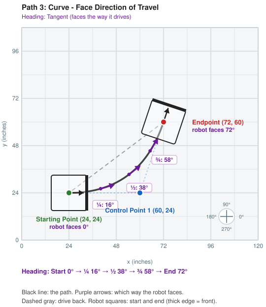
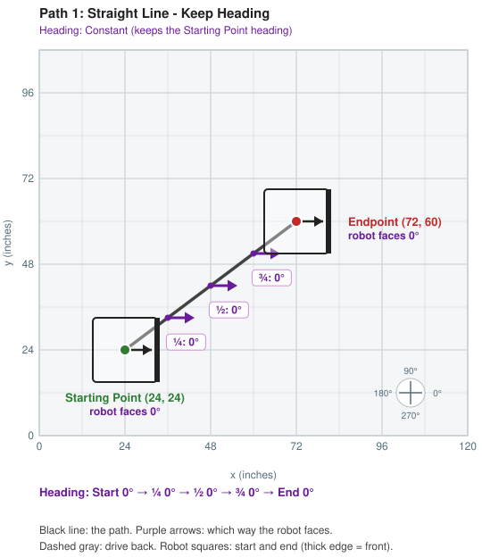
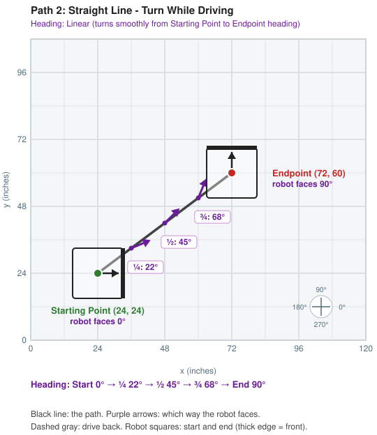
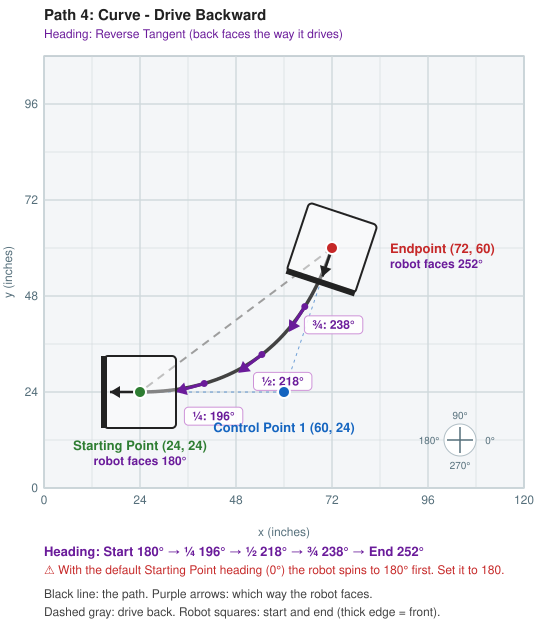
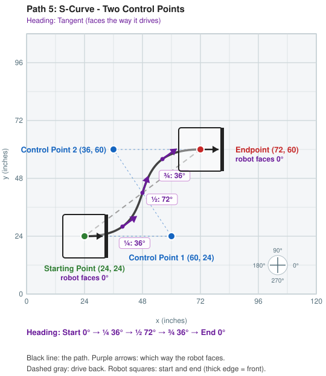
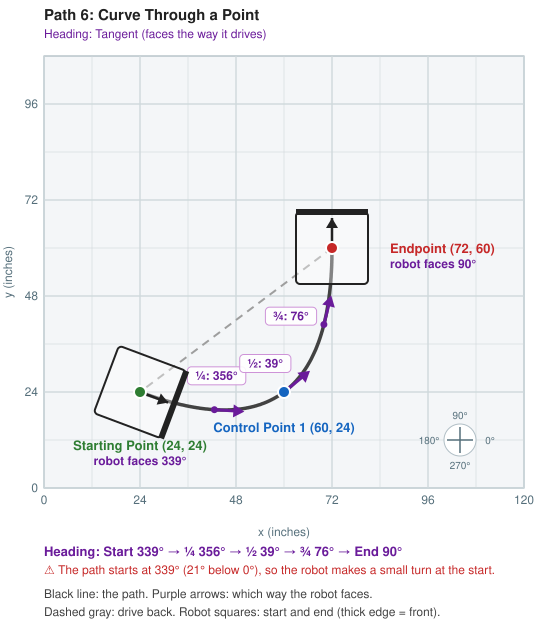
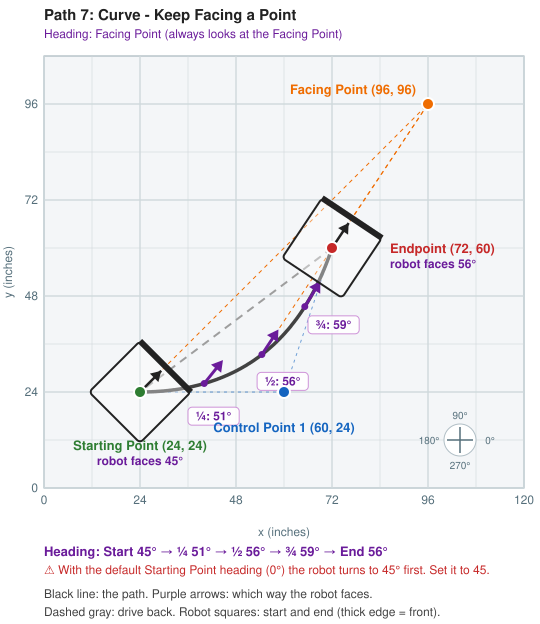

# Path Tests: User Guide

| | |
|---|---|
| **Project** | PathLab (SMRC FTC 2026) |
| **Audience** | Students running the Path Tests on the robot |
| **Related** | [High Level Design](PathTests-HLD.md) · [Low Level Design](PathTests-LLD.md) (code walkthrough, field setup, troubleshooting) |

This guide shows **what the robot should do in each Path Test** when you use the
**default points** from `configurations/PathPoses.java`. Look at the picture *before* you
press A, then watch the robot and compare.

---

## 1. The default points

Every test uses the same points. These are the starting values in `PathPoses.java`
(Dashboard: **Configuration → Path Poses**):

| Point | x | y | heading | Used by |
|---|---|---|---|---|
| **Starting Point** (green) | 24 | 24 | 0 | all tests |
| **Control Point 1** (blue) | 60 | 24 | not used | tests 3, 4, 5, 6, 7 |
| **Control Point 2** (blue) | 36 | 60 | not used | test 5 |
| **Endpoint** (red) | 72 | 60 | 90 | all tests (heading used only by test 2) |
| **Facing Point** (orange) | 96 | 96 | not used | test 7 |

Pause at the Endpoint: **2 seconds** (`PAUSE_AT_ENDPOINT_SECONDS`).

## 2. How to read the pictures

- **x and y** are inches, the same as the [Pedro Pathing Visualizer](https://visualizer.pedropathing.com/).
  (0, 0) is the bottom-left corner of the field. Only the bottom-left part of the field is shown.
- **Heading**: 0 = facing right (→), 90 = facing up (↑), 180 = facing left (←), 270 = facing down (↓).
- **Black line**: the path the robot drives.
- **Title**: the test name, and the **heading** type (Constant, Linear, Tangent, Reverse Tangent,
  Facing Point) with what it means.
- **Purple arrows** with labels such as **"½: 45°"**: which way the **front** of the robot points
  when it is ¼, ½ and ¾ of the way along the path.
- **Robot squares** (18 × 18 inches): the robot at the start and at the end. The **thick edge** and the
  black arrow show the **front**. **"robot faces …°"** under the Starting Point and Endpoint names gives
  the heading there.
- **Heading strip** (purple, under the field): all five headings in order, Start → ¼ → ½ → ¾ → End.
  A **red ⚠ line** under it warns about a turn at the start (tests 4, 6 and 7).
- **Compass** (bottom right): 0° right, 90° up, 180° left, 270° down.
- **Thin blue dotted lines**: connect the Control Points. They show what is *pulling* the curve.
  The robot does not drive along them.
- **Dashed gray line**: after the pause, the robot drives **straight back** to the Starting Point,
  turning back to the Starting Point heading on the way.

> **The picture is the plan, not a promise.** The real robot will be a little off the line.
> How far off is exactly what the telemetry ("Off the path right now", and "biggest miss" in
> "Last run") and the purple trail on the Dashboard field show you.

> **Where the robot thinks it is.** When you press PLAY, the OpMode *tells* the robot
> "you are at the Starting Point (24, 24)". Put the center of the robot on that spot of the
> field, facing the Starting Point heading. If you put it somewhere else, it drives the same
> shape, just moved over.

---

## 3. What each test should do

The heading numbers in each table are worked out from Pedro Pathing's own math, at the start,
¼, ½, ¾ and the end of the path (by distance driven).

### Path 1: Straight Line - Keep Heading

**What you should see:** the robot drives in a **straight diagonal line** up and to the right,
about **60 inches**. It **never turns**: it keeps facing right (0°) the whole way, so it slides
diagonally like a crab.

| | Start | ¼ | ½ | ¾ | End |
|---|---|---|---|---|---|
| Heading (°) | 0 | 0 | 0 | 0 | 0 |

**Notice:** the Endpoint heading (90) is **ignored**. The robot arrives still facing right.
The drive back uses the same line, so the dashed gray line is hidden under the black one.

---

### Path 2: Straight Line - Turn While Driving

**What you should see:** the **same straight line** as Path 1, but the robot **turns smoothly
while it drives**, from facing right (0°) to facing up (90°). It finishes the turn exactly when it
arrives.

| | Start | ¼ | ½ | ¾ | End |
|---|---|---|---|---|---|
| Heading (°) | 0 | 22 | 45 | 68 | 90 |

**Compare with Path 1:** same line, different heading. Is the robot as accurate when it turns?

---

### Path 3: Curve - Face Direction of Travel

**What you should see:** the robot starts driving **right**, toward Control Point 1, then
**curves up** to the Endpoint, about **65 inches**. The front always points **the way it is driving**,
like a car. It **does not touch** Control Point 1. The point only pulls the curve toward it.

| | Start | ¼ | ½ | ¾ | End |
|---|---|---|---|---|---|
| Heading (°) | 0 | 16 | 38 | 58 | 72 |

**Notice:** the robot ends facing about **72°**, the direction it was driving at the end, **not** the
Endpoint heading (90).

---

### Path 4: Curve - Drive Backward

**What you should see:** the **same curve as Path 3**, but the robot drives it **backward**. Its
**back** points the way it is driving, so the front points behind it.

| | Start | ¼ | ½ | ¾ | End |
|---|---|---|---|---|---|
| Heading (°) | 180 | 196 | 218 | 238 | 252 |

**Before you start:** the path wants the robot to start facing **left (180°)**, but the default
Starting Point heading is **0**. With the default, the robot will **spin halfway around** in the
first part of the path. To avoid the spin, set **STARTING_POINT → heading = 180** in Dashboard and
place the robot facing left. (The picture shows the robot already facing 180.)

---

### Path 5: S-Curve - Two Control Points

**What you should see:** an **S shape**, about **66 inches**. Control Point 1 (bottom right) pulls the
start of the path to the right. Control Point 2 (top left) pulls the end of the path to the left.
The robot leaves facing right, turns to face up and to the right in the middle, then **turns back** to
face right as it arrives.

| | Start | ¼ | ½ | ¾ | End |
|---|---|---|---|---|---|
| Heading (°) | 0 | 36 | 72 | 36 | 0 |

**Notice:** the robot touches **neither** Control Point. It ends facing **right (0°)**, not the Endpoint
heading (90).

---

### Path 6: Curve Through a Point

**What you should see:** a curve that **drives right over Control Point 1**, then sweeps up to the
Endpoint, about **77 inches**, the longest test. To pass *through* the point, the path first dips
about **4.5 inches below** y = 24 and then comes back up. The front points the way it is driving.

| | Start | ¼ | ½ | ¾ | End |
|---|---|---|---|---|---|
| Heading (°) | 339 (= −21) | 356 (= −4) | 39 | 76 | 90 |

**Compare with Path 3:** same three points. In Path 3 Control Point 1 only *pulls*. Here the robot
*drives over it*.

**Notice:** the path starts facing slightly **down-right** (−21°), but the robot starts at 0°, so
expect a **small turn** at the very beginning.

---

### Path 7: Curve - Keep Facing a Point

**What you should see:** the **same curve as Path 3**, but the robot **keeps looking at the Facing
Point** (96, 96) the whole time, like a camera tracking a target. The orange dashed lines show where it
is looking. Because the Facing Point is far away, the robot only turns a little.

| | Start | ¼ | ½ | ¾ | End |
|---|---|---|---|---|---|
| Heading (°) | 45 | 51 | 56 | 59 | 56 |

**Before you start:** the path wants the robot to start facing the Facing Point (**45°**), but the
default Starting Point heading is **0**. With the default, the robot will **turn 45°** right at the start.
To avoid that, set **STARTING_POINT → heading = 45** in Dashboard and place the robot facing up-right.

**Notice:** the heading goes up to 59° and then comes back to 56°. The heading depends only on
**where the robot is** compared with the Facing Point. It does not depend on which way the path goes.

---

## 4. Summary

| Test | Shape | Length (in) | Robot faces | Ends facing |
|---|---|---|---|---|
| 1 | straight line | 60 | the same way (0°) | 0° |
| 2 | straight line | 60 | turns smoothly 0° → 90° | 90° |
| 3 | curve (pulled by CP1) | 65 | the way it drives | 72° |
| 4 | curve (pulled by CP1) | 65 | backward | 252° |
| 5 | S-curve (CP1 + CP2) | 66 | the way it drives | 0° |
| 6 | curve through CP1 | 77 | the way it drives | 90° |
| 7 | curve (pulled by CP1) | 65 | at the Facing Point | 56° |

After every test: **2 seconds** pause, then a **straight line back** to (24, 24), turning back to the
Starting Point heading.

## 5. Things to try

1. **Run 1 then 2.** Same line. Which one misses the line more?
2. **Run 3 then 6.** Which one goes over the blue dot? When would you want each one in an autonomous?
3. **Run 3 then 4.** Is driving backward as accurate as driving forward?
4. **Path 5:** move Control Point 2 to (60, 60), on the *same* side as Control Point 1. Is it still an S?
5. **Path 7:** move the Facing Point to (72, 24), right next to the path. What happens to the turning?
6. **Any test:** change a point in Dashboard. During INIT the Dashboard field shows the new path before
   the robot moves. Compare it with the picture in this guide.

> If you change the points, the pictures in this guide no longer match. Use the Dashboard field
> picture (or the [Visualizer](https://visualizer.pedropathing.com/)) to see the new path.
